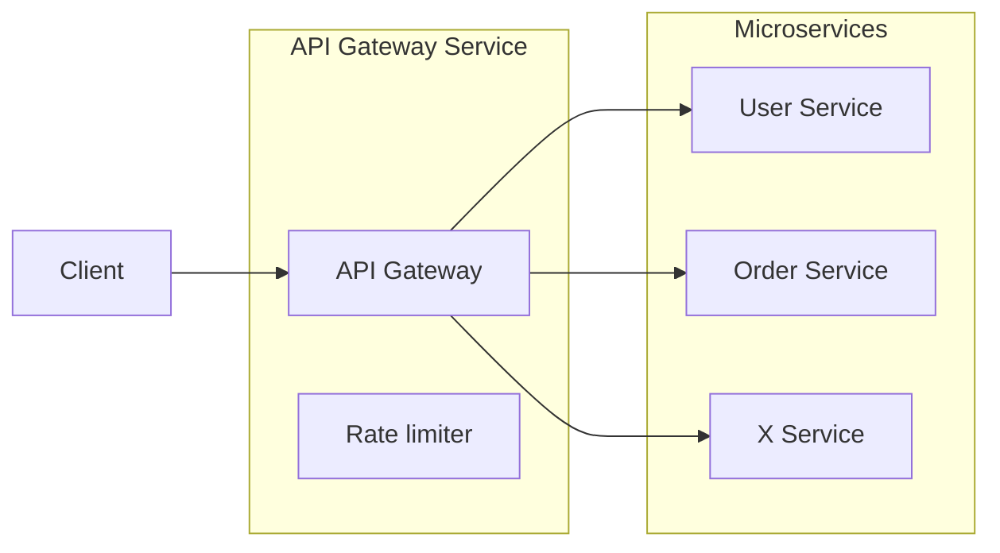
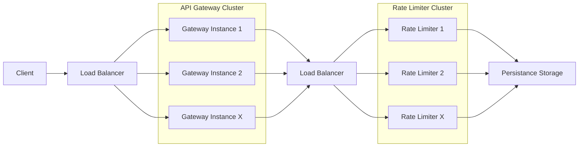
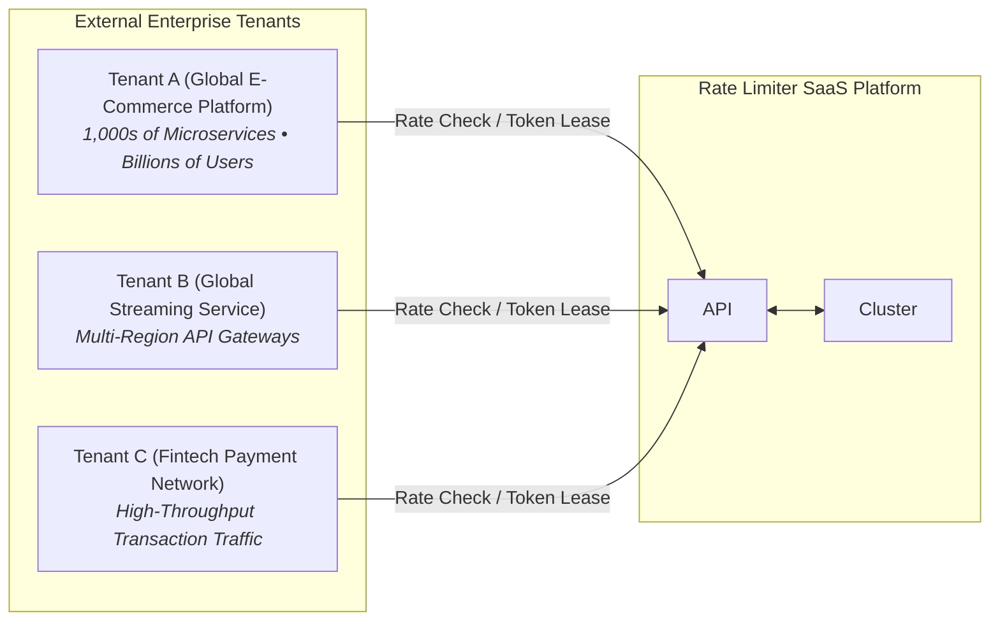
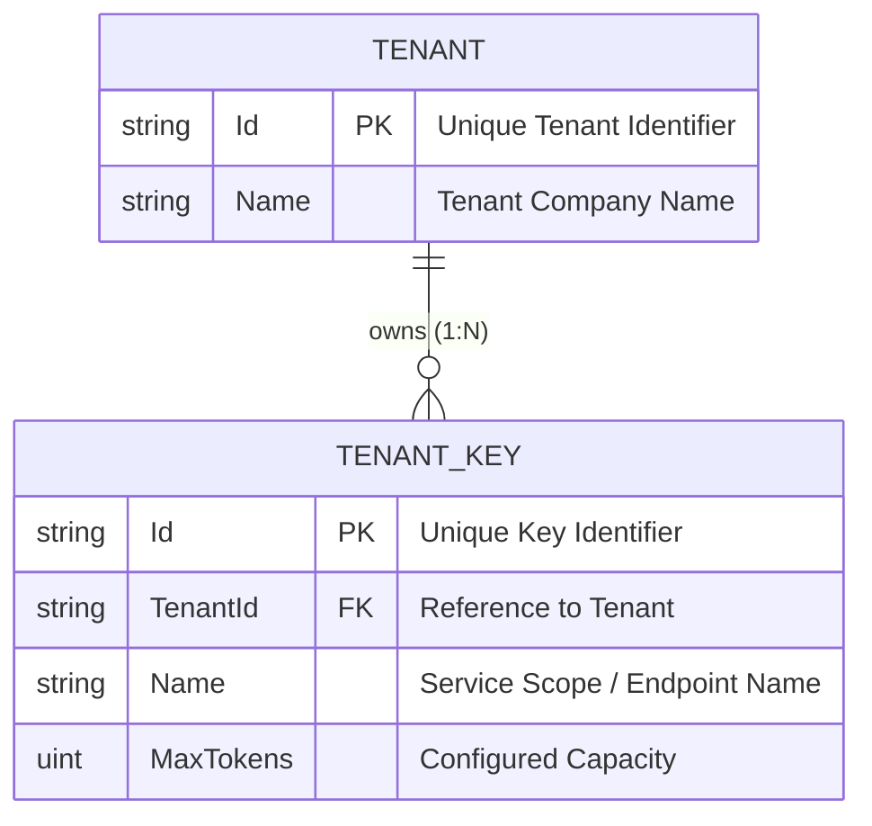
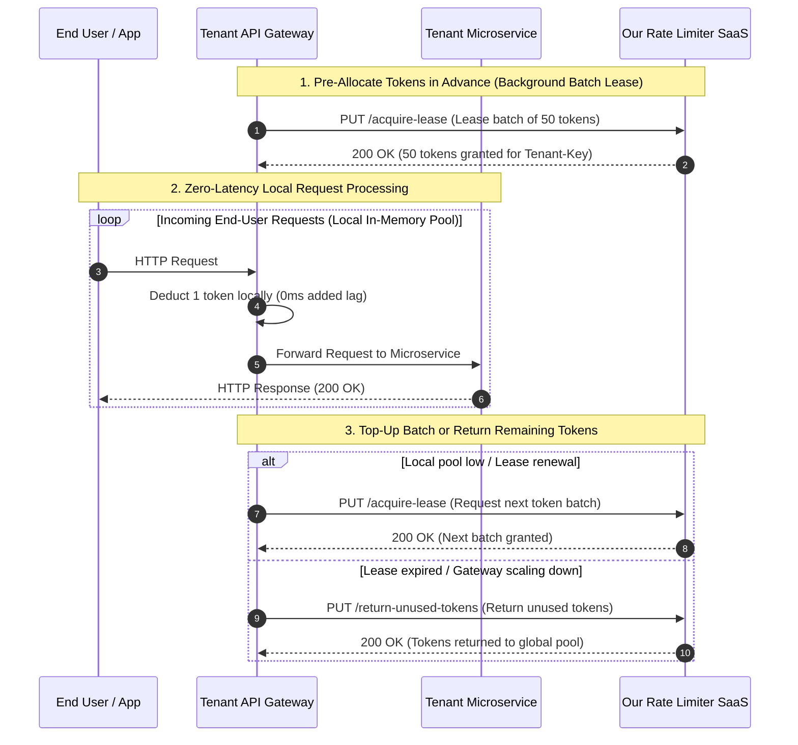
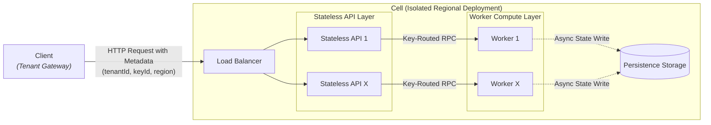
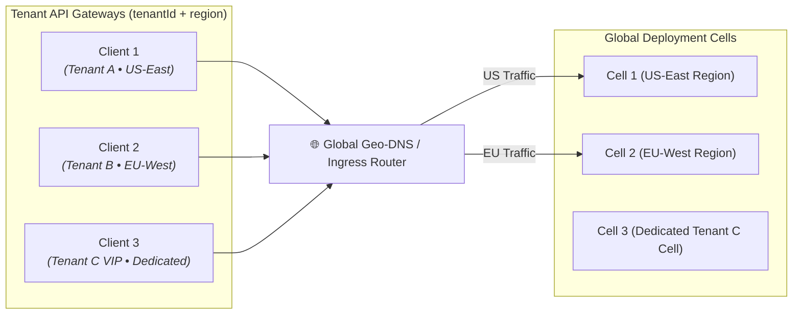
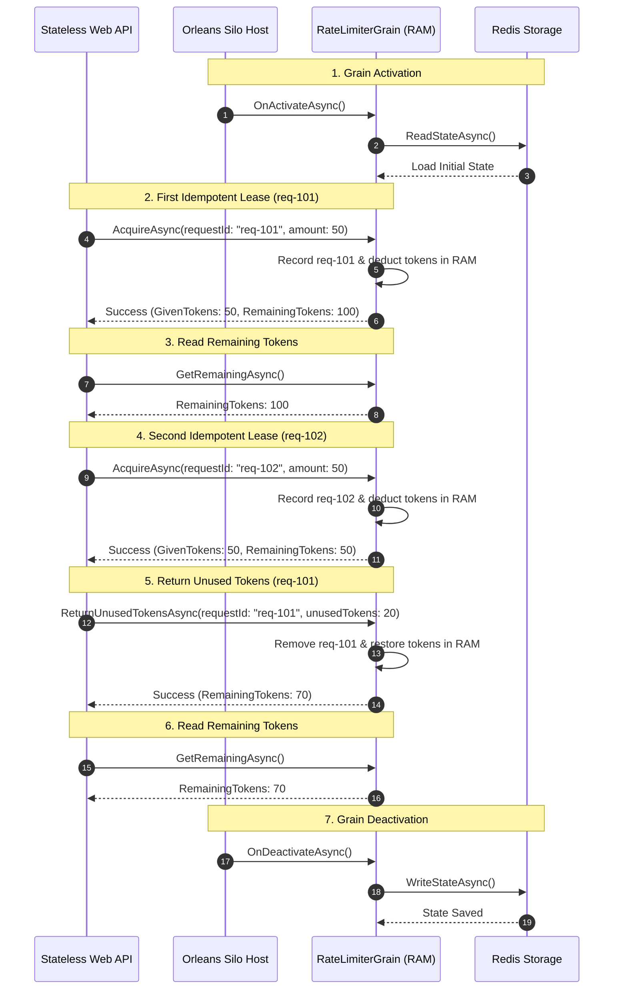

# Distributed Rate Limiter (.NET Aspire + Microsoft Orleans)

A high-performance rate limiting service built with **.NET Aspire** and **Microsoft Orleans**. It is designed to run as a multi-tenant SaaS that handles massive API Gateway traffic without slowing down user requests.


## 2. What is a Classic Rate Limiter?

### 2.0 What Issue It Solves
Think of a rate limiter as a security guard at the door of your system. It keeps track of incoming traffic and caps how many requests a user, IP, or API key can make in a given timeframe.

Without a rate limiter, a few common problems occur:
* **Server Overload & Outages:** A sudden spike in requests (or a DDoS attack) can knock down your backend services and databases.
* **Cascading Failures:** If one microservice gets bogged down, it backs up traffic across your entire architecture.
* **The "Noisy Neighbor" Problem:** In multi-tenant systems, one customer running a bad script could consume all available capacity and ruin the experience for everyone else.
* **Unexpected API Bills:** Uncapped access to monetized APIs (like LLMs or paid third-party services) can run up massive bills fast.

### 2.1 Rate Limiter as Part of an API Gateway
In most architectures, the rate limiter sits right inside the **API Gateway**. The gateway acts as the single front door for all incoming client traffic—handling things like authentication, routing, and rate checking before handing requests off to backend microservices.



In simple setups or monolithic apps, the rate limiter runs in-memory directly inside the API Gateway process (using a `ConcurrentDictionary` or local memory cache).

Why this works great for small setups:
* **Blazing Fast:** Checking a limit takes less than a microsecond because there are no network calls.
* **Zero Complexity:** You don't need external databases, Redis clusters, or complex sync logic.

### 2.3 Rate Limiting Algorithms
* **Token Bucket:** Refills tokens at a steady rate; requests consume tokens. Supports bursts.
* **Leaky Bucket:** Queues requests and processes them at a constant output rate. Smooths spikes.
* **Fixed Window Counter:** Counts requests in fixed time blocks and resets each window.
* **Sliding Window Log:** Logs exact request timestamps and purges outdated ones for precise limiting.
* **Sliding Window Counter:** Blends current window count with a weighted overlap of the previous window.

## 3. Distributed Rate Limiter

### 3.1 What Happens During Scaling?
As application traffic grows, a single API Gateway instance becomes a bottleneck and must scale out horizontally into multiple instances behind a load balancer.

> 💡 **Architectural Note:**  
> Workload CPU/memory saturation isn't the only reason to scale out. Requirements like geographic latency (multi-region ping), fault isolation, zero-downtime rolling deployments, and high availability force you to split across multiple Gateway instances long before hitting resource limits on a single machine.

Scaling out introduces key challenges:
* **Loss of Single-Process Limiter:** We lose the single in-memory rate limiter bounded to one gateway process. Each gateway instance tracks requests in its own isolated memory, breaking global limits (e.g., 10 instances allowing 10x the intended traffic).
* **Big Impact on Latency:** Every incoming HTTP request must now make a remote network call to the central rate limiter cluster. What used to be a sub-microsecond ($< 1\mu s$) in-memory check now adds **2–10ms+ of network latency** directly on the critical path of every request.

To enforce global limits, rate limiting is extracted out of individual gateways and into a shared **Rate Limiter Cluster** called by all API Gateway instances:



### 3.2 Distributed Systems Issues
Moving to a shared distributed rate limiter solves the accuracy problem, but it introduces real distributed systems pain points:

1. **Latency on the Hot Path:** Now every single HTTP request to your gateway has to make a remote network hop to the central rate limiter before proceeding. That adds 2 to 10 milliseconds of latency to every single request.
2. **Race Conditions & Locking:** When thousands of gateway instances try to update the exact same counter at the same time, you get race conditions. You end up needing distributed locks (like Redis Redlock) or atomic scripts, which slow things down further.
3. **Availability Risk (Single Point of Failure):** If your central rate limiter or Redis cluster goes down, your API Gateways either have to block all traffic (causing a total outage) or let all traffic through (exposing your backend to overload).
4. **Hot-Spotting:** A sudden flood of traffic for one popular tenant or endpoint can hammer a single database shard or cache key, creating a bottleneck for the entire system.

## 4. Rate Limiter as SaaS

### 4.1 What is Rate Limiter as a SaaS?
Now that we know how to build a basic distributed rate limiter, let's raise the bar and design a real enterprise-grade **Rate Limiter as a Service (SaaS)** solution.

Instead of building a rate limiter for just one application, we are providing rate limiting as a centralized, multi-tenant platform for external enterprise platforms, which we call **Tenants**.

These tenants are massive global platforms—running thousands of microservices, handling billions of active users, and processing millions of requests per second worldwide. Rather than every tenant spending engineering effort building and managing their own rate-limiting clusters, they offload rate limiting entirely to our SaaS platform.

Before looking at the architecture, let's clarify what **"our client"** actually is:
* **Our Client = A Tenant's API Gateway Instances.** Our service does not talk directly to individual end-user mobile apps or browsers. Instead, our direct clients are the API Gateway instances deployed by our enterprise tenants.

#### High-Level System Overview:



### 4.2 Requirements Clarification (System Design Step 1)

#### 1. Functional Requirements (FRs)
A **Tenant** represents an enterprise customer. Each tenant configures one or more **TenantKeys** (e.g., `search-service`, `payment-api`) to manage rate limits per service endpoint or scope.

The rate limiting partition key formula is strictly evaluated as:
$$\text{PartitionKey} = \text{\{TenantID\}-\{KeyID\}}$$



##### API Specification Table

Tenant API Gateways interact with our SaaS platform via the following REST API endpoints:

| HTTP Method | Endpoint Path | Headers | Body / Query Parameters | Description |
| :--- | :--- | :--- | :--- | :--- |
| `POST` | `/api/v1/limiter/setup` | `tenantId` | `{ maxTokens }` | Initializes/configures rate limit capacity (`MaxTokens`) for key `{tenantId}-{keyId}`. |
| `PUT` | `/api/v1/limiter/{keyId}/acquire-lease` | `tenantId` | `{ requestId, requestAmount }` | Idempotently leases a batch of tokens (`requestAmount`) for gateway request `requestId`. |
| `PUT` | `/api/v1/limiter/{keyId}/return-unused-tokens` | `tenantId` | `{ requestId, unusedTokens }` | Idempotently returns `unusedTokens` back to the global bucket pool for active lease `requestId`. |
| `GET` | `/api/v1/limiter/{keyId}/get-remaining-tokens` | `tenantId` | - | Queries currently available remaining tokens for `{tenantId}-{keyId}`. |

* **Idempotent Token Leasing:** Every token acquisition and return call requires a unique client-side `requestId`. If a network blip or timeout causes an API gateway to retry a lease request, the system detects the existing `requestId` in memory and prevents double token deduction.

#### 2. Non-Functional Requirements (NFRs)
* **Ultra-Low Latency:** p99 latency $< 2\text{ms}$ for direct SaaS API calls; **0ms added latency** when tenant gateways serve requests from local token pools.
* **High Scale & Throughput:** Support **1,000,000+ global RPS** across 100k+ tenant API Gateway nodes.
* **Zero Lock Contention:** High-concurrency state updates per key must execute without distributed lock starvation (avoiding `Redlock` bottlenecks).
* **Consistency Guarantee (Regional Model):** **Strong consistency per regional cluster**, but **no global cross-region consistency guarantee**. Each region manages token accounting independently for local tenant gateways.

#### 3. Back-of-the-Envelope Estimations
* **Traffic Reduction via Batch Leasing:**
  - Global end-user traffic: **1,000,000 RPS**.
  - Leasing batch size: **50 tokens per request**.
  - SaaS Ingress Traffic: $1,000,000 / 50 = \mathbf{20,000\text{ RPS}}$ (**98% reduction** in network calls).
* **In-Memory Storage Footprint:**
  - Active key state size: `TenantId` (36B) + `KeyId` (36B) + `RemainingTokens` (4B) + `MaxTokens` (4B) + `LastRefillTime` (8B) $\approx$ **128 bytes per active key**.
  - 10,000,000 active keys $\times$ 128 bytes = **~1.28 GB RAM** total memory capacity across the rate-limiting cluster.
* **Backing Storage Write Savings:**
  - Background asynchronous state flushes (on state deactivation or periodic timer ticks) reduce storage write IOPS from 20,000 writes/sec down to **$< 100$ writes/sec**.
* **Workload & Storage Takeaway:**
  - The system is strictly **Read/Write intensive** (every token lease operation mutates state).
  - We **cannot rely on simple passive caching** (e.g. standard read-aside cache) due to continuous state mutations and concurrency race conditions.
  - A fast **NoSQL key-value data store** is suited for backing the asynchronous state persistence layer.

### 4.3 Eliminating Input Lag: Batch Token Leasing Protocol

To solve the network latency ("input lag") problem on every end-user request, tenant API Gateways do **not** call our SaaS platform synchronously for every incoming HTTP request. 

Instead, we pre-allocate tokens **in advance** using a **Batch Token Leasing Protocol**:

1. **Pre-Allocation in Advance:** When a tenant's API Gateway instance boots or runs low on tokens, it requests a block of tokens in advance (e.g. 50 tokens) via `PUT /acquire-lease`.
2. **Zero-Latency Local Consumption:** The tenant gateway handles incoming end-user requests locally from its in-memory leased token pool with **0ms added network lag**.
3. **Returning Remaining Tokens:** When a lease expires or a tenant gateway scales down, any unused remaining tokens are returned back to our global SaaS pool via `PUT /return-unused-tokens`.

#### Request Sequence Flow:



### 4.4 High-Level Design (System Design Step 2)

Client requests carry key metadata (`tenantId`, `keyId`, `region`) in HTTP headers to route and partition rate limiting operations.

#### Components & Cell Boundary:

* **Client:** Tenant API Gateway instance requesting or returning token batches.
* **Request Metadata:** Incoming HTTP call carrying `tenantId`, `keyId`, and `region` headers.
* **Cell (Isolated Regional Deployment):**
  * **Load Balancer:** Ingress load balancer receiving incoming tenant requests and distributing traffic across stateless API nodes.
  * **Stateless API Layer:** Scaled-out REST API instances handling authentication, request validation, and routing.
  * **Worker Compute Layer:** Scaled-out compute worker nodes running in-memory single-threaded partition logic per key (`${tenantId}-${keyId}`).
  * **Persistence Storage:** Backing NoSQL store persisting state updates asynchronously off the critical path.

#### High-Level Architecture Diagram:



#### Primary Data Flow:
1. **Client** sends request with `tenantId` + `keyId` metadata $\rightarrow$ **Load Balancer**.
2. **Load Balancer** forwards request $\rightarrow$ **Stateless API N**.
3. **Stateless API** routes via RPC $\rightarrow$ **Worker N** (computes token bucket in-memory).
4. **Worker** periodically flushes state $\rightarrow$ **Persistence Storage** asynchronously.

#### Global Multi-Cell Topology & Tenant Isolation

Once an individual cell is designed, the full global system is composed of multiple autonomous deployment cells. In this macro architecture, each cell operates as an isolated black-box unit.

Incoming client requests carry `(tenantId + region)` metadata. The global ingress router directs traffic to the corresponding cell, providing two levels of isolation:
1. **Regional Fault Isolation:** An outage or traffic surge in `Cell 1 (US-East)` cannot affect `Cell 2 (EU-West)`.
2. **Dedicated Tenant Isolation:** High-volume or sensitive enterprise tenants (e.g. `Tenant C`) can be placed in a dedicated cell (`Cell 3`), guaranteeing zero noisy-neighbor impact and custom regional SLAs.



### 4.5 Deep Dive & Bottleneck Scaling (System Design Step 4)

#### 1. Horizontal Scaling Mechanics
Our architecture provides two distinct scaling dimensions:
* **Intra-Cell Scaling (Scaling Within a Cell):** As tenant traffic increases within a region, capacity scales horizontally by adding Stateless API nodes and Worker compute instances inside that cell.
* **Extra-Cell Scaling (Scaling Across Regions):** As global footprint grows, capacity scales out by deploying new regional cells (e.g. `EU-Central`, `AP-East`) or dedicated tenant cells for high-volume VIP customers.

#### 2. CAP Theorem & Consistency Trade-Offs
* **AP System Model (Availability & Partition Tolerance):** We explicitly trade off global cross-region strong consistency to achieve sub-millisecond availability and regional isolation.
* **Eliminating Cross-Region Sync:** Because each regional cell operates independently, we eliminate inter-continental network hops, cross-ocean locking, and complex database replication topologies.
* **No Database Replication Overhead:** Backing NoSQL stores remain strictly local to their deployment cell. There is zero cross-region DB replication lag or conflict resolution overhead.

#### 3. Core Bottlenecks & Architectural Challenges Within a Cell

##### Challenge A: Concurrency & Distributed Locking
* **The Bottleneck:** Thousands of concurrent token lease requests for the same tenant key (`tenantA-search-service`) cause race conditions. Traditional distributed locking mechanisms (e.g., Redis `Redlock`, database mutexes) create massive lock contention, thread starvation, and latency spikes.
* **Architectural Requirement:** Key state mutations must execute in-memory with **zero lock contention** (e.g. single-threaded actor per key partition or lock-free atomic processing).

##### Challenge B: In-Memory State & Storage Write Reduction
* **The Bottleneck:** Since token leasing is **Read/Write intensive** (state changes on every lease request), writing to backing database disk synchronously would overwhelm storage IOPS and degrade throughput.
* **Architectural Requirement:** Active key partitions must be loaded and executed in worker memory for instant updates. State writes to the backing NoSQL database must occur **asynchronously off the hot path** (via periodic timer flushes or partition deactivation).

### 4.6 Implementation & Technology Choice: Microsoft Orleans & Redis (System Design Step 5)

Now that we have defined our requirements, cell architecture, and scaling bottlenecks, we select **Microsoft Orleans** and **Redis** as the implementation engine for each cell.

#### 1. Orleans Cluster Deployment Within a Cell
Each regional deployment cell runs its own isolated **Orleans Cluster**:
* **Silos Replace Worker Machines:** Generic compute workers from Step 2 are implemented as **Orleans Silo** hosts (`DistRateLimiter.OrleansSilo.WebApp`).
* **Dual-Purpose Redis Infrastructure:** Within each cell, Redis handles two distinct roles:
  - **Cluster Membership:** Tracks active Orleans Silos and node discovery.
  - **Grain Persistence (`tokensStore`):** Stores virtual actor state snapshots (`RateLimiterGrainState`).

#### 2. How Microsoft Orleans Resolves Our Key Bottlenecks

* **Lock-Free Concurrency (Queue-Based Execution):**  
  Orleans guarantees **single-threaded execution per virtual actor** (`RateLimiterGrain`). Requests for the same partition key (`${tenantId}-${keyId}`) queue sequentially in memory. This eliminates distributed locks (`Redlock`), mutexes, and database race conditions completely.

* **In-Memory Speed & Reduced Network Hops:**  
  Active grains live directly in Silo RAM. Orleans automatically routes RPC calls from API nodes to the exact Silo hosting the target grain—eliminating database lookup hops on the hot path.

* **Dramatically Reduced Storage Traffic:**  
  - **Reads:** State is loaded from storage **only when a Grain activates** for the first time.  
  - **Writes:** Updates are saved to Redis asynchronously **only on periodic timer ticks or Grain deactivation**, keeping database disk IOPS off the critical path.

* **Idempotency & Network Retry Safety (`requestId`):**  
  Every token lease operation (`AcquireAsync`, `ReturnUnusedTokensAsync`) requires a unique client-generated `requestId`. The grain tracks active acquisitions in an in-memory dictionary (`ClientAcquireCollection`). If an API gateway retries a request due to a network timeout or dropped connection, the grain detects the existing `requestId` and rejects duplicate token deductions (`Request ID already exists`).

#### Request & Storage Flow Sequence



### 4.7 Architectural Summary & Trade-Off Analysis

To wrap up our System Design, let's analyze the core technical challenges our solution solves, its key pros and cons, and why this architecture is highly effective for large-scale distributed systems.

#### 1. Core Technical Challenges Solved (What We Fixed)

* **Eliminated Network Latency on the Critical Path:**  
  * *Traditional Problem:* Every incoming HTTP request requires a remote round-trip to Redis ($2\text{--}10\text{ms}$ added lag).  
  * *Our Solution:* Combining **Client Token Batch Leasing** (Step 4.3) with **In-Memory Orleans Grains** (Step 4.6) reduces remote rate-check calls by over **98%**. Tenant gateways evaluate $99\%+$ of user requests instantly from local token pools ($0\text{ms}$ added network lag).

* **Eliminated Distributed Lock Contention:**  
  * *Traditional Problem:* High-volume endpoints cause severe mutex lock starvation (e.g. Redis `Redlock` bottlenecks) when thousands of instances mutate shared counters concurrently.  
  * *Our Solution:* Orleans virtual actors enforce **single-threaded, queue-based execution per key partition** (`${tenantId}-${keyId}`). Mutexes and distributed locks are completely eliminated.

* **Guaranteed Idempotency & Retry Protection:**  
  * *Traditional Problem:* Network timeouts or retries during token acquisition can cause double-deduction of tokens, penalizing client gateways.  
  * *Our Solution:* Every lease request carries a unique `requestId` tracked in the grain's in-memory `ClientAcquireCollection`. Retried requests are recognized instantly, preventing duplicate token deductions.

* **Dramatically Reduced Storage IOPS & Costs:**  
  * *Traditional Problem:* Synchronous database writes per request crush storage IOPS and run up massive infrastructure bills.  
  * *Our Solution:* Database reads happen **only on Grain activation**, and writes happen **only asynchronously via timer flushes or deactivation**. Storage traffic is slashed by orders of magnitude.

* **Fault Isolation & Blast Radius Control:**  
  * *Traditional Problem:* A global database failure or noisy-neighbor tenant can bring down the entire rate limiter for all enterprise customers.  
  * *Our Solution:* Our **Global Multi-Cell Topology** guarantees regional fault isolation. High-volume enterprise VIP tenants can be isolated into dedicated cells with zero noisy-neighbor risk.

#### 2. Pros & Cons (Architectural Trade-Offs)

| Metric / Dimension | Pros (Strengths) | Cons & Trade-Offs |
| :--- | :--- | :--- |
| **Performance & Latency** | Sub-millisecond RPC calls inside Silo RAM; zero added latency for batch-leased requests at the tenant gateway. | Initial cold-start request for an inactive Grain requires a single Redis read to hydrate state. |
| **Concurrency & Safety** | Lock-free queue processing per actor prevents race conditions and lock starvation. | Execution per partition key is serialized on a single Grain instance (though partitioned across the cluster by key). |
| **Scalability & Cost** | Scales out linearly by adding API nodes and Silos; slashes Redis storage IOPS requirements by $98\%+$. | Requires running and managing an Orleans cluster (membership, silo clustering, lifecycle management). |
| **Resilience & Availability** | If a Silo host fails, Orleans automatically reactivates grains on healthy Silos with state restored from Redis. | In an abrupt host crash, unflushed token updates since the last background timer tick could be lost (fail-open strategy). |
| **Consistency Model** | Strong regional consistency within each deployment cell. | No global cross-region strong consistency (traded off to eliminate inter-continental network latency). |

#### 3. Key Architectural Takeaways

1. **Batching is King for High Throughput:** Pre-allocating leases to edge gateways is the most effective way to eliminate network bottlenecks in distributed rate limiting.
2. **Virtual Actors are a Perfect Fit:** Actor models (Microsoft Orleans) solve state concurrency without distributed locks by treating partition keys as isolated, single-threaded in-memory objects.
3. **Cells Provide Operational Peace of Mind:** Structuring global infrastructure into independent deployment cells guarantees that a failure in one region never becomes a global outage.

## 5. Repository Info

### Prerequisites
* **.NET 9 SDK**
* **Docker Desktop** (used by .NET Aspire to spin up Redis automatically)


### How to Run
Start the entire stack (Aspire Dashboard, REST API, Orleans Silos, and Redis) with one command:

```bash
dotnet run --project src/Aspires/DistRateLimiter.Aspires.AppHost
```

Once running, you can access:
* **Aspire Dashboard:** `https://localhost:17228` (Traces, logs, and resource health)
* **REST API (Scalar UI):** `https://localhost:<api-port>/scalar/v1`
* **Orleans Dashboard:** `https://localhost:<silo-port>/orleans-dashboard`


### HTTP API Endpoints

| Method | Route | What it does |
| :--- | :--- | :--- |
| `POST` | `/api/v1/limiter/setup` | Sets up a rate limit rule for a given tenant and key. |
| `PUT` | `/api/v1/limiter/{keyId}/acquire-lease` | Leases a batch of tokens for a gateway instance. |
| `PUT` | `/api/v1/limiter/{keyId}/return-unused-tokens` | Returns unused tokens back to the pool. |
| `GET` | `/api/v1/limiter/{keyId}/get-remaining-tokens` | Checks how many tokens are currently left. |

### Project Structure

```
DistRateLimiter/
├── src/
│   ├── DistRateLimiter.Core/                        ← Interfaces and shared DTO models
│   ├── DistRateLimiter.Features/                    ← RateLimiterGrain actor implementation
│   ├── DistRateLimiter.WebApiApp/                   ← REST API endpoints (Orleans client)
│   ├── OrleansSilo/
│   │   └── DistRateLimiter.OrleansSilo.WebApp/      ← Orleans Silo host & web dashboard
│   └── Aspires/
│       ├── DistRateLimiter.Aspires.AppHost/         ← Aspire orchestrator
│       └── DistRateLimiter.Aspires.ServiceDefaults/ ← OpenTelemetry & health defaults
├── tests/
│   ├── DistRateLimiter.Grain.Tests/                ← Fast in-memory actor unit tests
│   └── DistRateLimiter.HostApplication.Tests/      ← Integration tests using Aspire host
└── DistRateLimiter.slnx                            ← Solution file
```

### Running Tests

```bash
dotnet test
```

## 📄 License
Licensed under the [MIT License](LICENSE).
